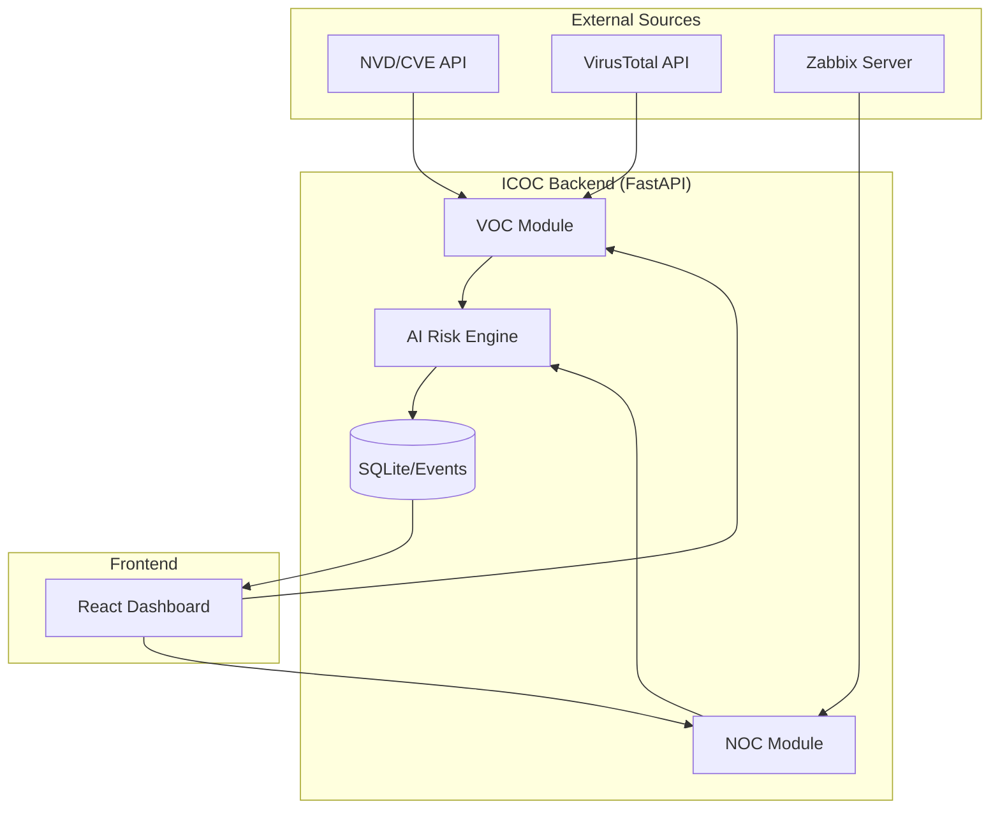

# ICOC-VOC-NOC: Integrated Cyber Operations Center

A unified platform combining **Vulnerability Operations Center (VOC)**, **Network Operations Center (NOC)**, and **AI-Driven Risk Orchestration**.

[](https://fastapi.tiangolo.com/)
[](https://reactjs.org/)
[](https://scikit-learn.org/)
[](https://www.docker.com/)

---

## 📑 Table of Contents
- [Overview](#-overview)
- [System Architecture](#-system-architecture)
- [Key Modules](#-key-modules)
- [Quick Start](#-quick-start)
- [Configuration](#-configuration)
- [ML Pipeline](#-ml-pipeline)
- [API Documentation](#-api-documentation)

---

## 🎯 Overview
ICOC-VOC-NOC is a comprehensive cybersecurity and network management solution. It bridges the gap between vulnerability management (VOC) and real-time network monitoring (NOC), using a specialized AI engine to correlate events, prioritize threats, and calculate a global risk score.

---

## 🏗️ System Architecture



---

## 🧩 Key Modules

### 🛡️ VOC (Vulnerability Operations)
- **Inventory Management**: Track software assets and versions.
- **Vulnerability Scanning**: On-demand scanning with VirusTotal integration.
- **CVE Integration**: Real-time fetching from NIST NVD database.
- **Compliance Tracking**: Mapping vulnerabilities to PCI-DSS, ISO 27001, and NIST frameworks.

### 🌐 NOC (Network Operations)
- **Real-time Monitoring**: Deep integration with Zabbix for alerts and metrics.
- **Incident Management**: Lifecycle tracking of network performance issues.
- **Automated Remediation**: Scripted responses to common network failures.
- **Predictive Analytics**: Forecasting metrics and SLA breach probability.

### 🤖 AI Engine
- **Risk Scoring**: Dynamic 0-100 global risk score calculation.
- **Prioritization**: ML-based ranking of security and network alerts.
- **Correlation**: Identifying links between NOC performance drops and VOC threats.
- **Anomaly Detection**: Isolation Forest model for detecting unusual CVE patterns.

---

## 🚀 Quick Start

### Docker Deployment (Recommended)

1.  **Clone the repository**:
    ```bash
    git clone https://github.com/ahmed-zrelli/ICOC.git
    cd ICOC
    ```

2.  **Configure environment**:
    ```bash
    cp .env.example .env # Ensure your API keys and Zabbix URLs are set
    ```

3.  **Start the platform**:
    ```bash
    docker-compose up --build
    ```

4.  **Initialize AI Models**:
    ```bash
    docker exec icoc-api python ai/train.py --synthetic
    ```

### Local Development

1.  **Backend**:
    ```bash
    pip install -r requirements.txt
    python main.py
    ```

2.  **Frontend**:
    ```bash
    cd frontend
    npm install
    npm run dev
    ```

---

## ⚙️ Configuration

The system is controlled via the `.env` file. Key parameters:

| Variable | Description | Default |
|----------|-------------|---------|
| `DEMO_MODE` | Enable simulated data for NOC/VOC | `true` |
| `ZABBIX_API_URL` | URL to your Zabbix RPC endpoint | `http://.../api_jsonrpc.php` |
| `VT_API_KEY` | Your VirusTotal API Key | `REQUIRED` |
| `DB_PATH` | Path to SQLite database | `icoc.db` |

---

## 🧠 ML Pipeline

The AI module uses three primary models:
- **Severity Classifier**: RandomForest model categorizing threats (Critical to Low).
- **Exploitability Regressor**: GradientBoosting model predicting potential CVSS impact.
- **Anomaly Detector**: Isolation Forest identifying outliers in threat intelligence.

Train with real data:
```bash
python ai/train.py --download --years 2022 2024
```

---

## 🔌 API Documentation

Once the server is running, access the interactive documentation:
- **Swagger UI**: [http://localhost:8000/docs](http://localhost:8000/docs)
- **ReDoc**: [http://localhost:8000/redoc](http://localhost:8000/redoc)

---
*Developed as part of the ICOC Integrated Security Framework.*
